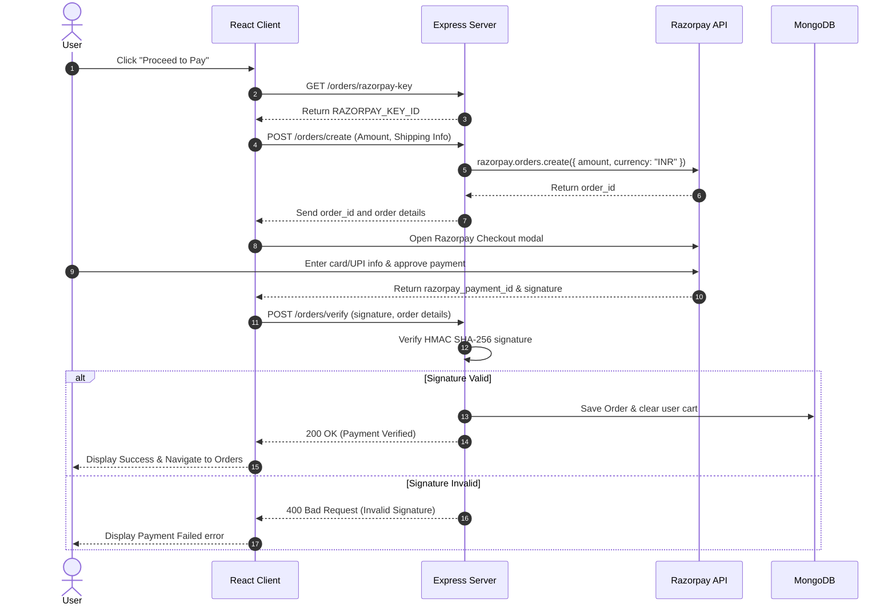

# 🛒 ShopKart - Full-Stack E-Commerce Platform

[](https://react.dev/)
[](https://vitejs.dev/)
[](https://tailwindcss.com/)
[](https://nodejs.org/)
[](https://www.mongodb.com/)
[](https://razorpay.com/)

ShopKart is a modern, full-stack e-commerce web application featuring user authentication, product catalog with dynamic filtering, persistent cart & wishlist management, customer profiles, and seamless online payment processing powered by Razorpay.

---

## 🌟 Key Features

### 👤 Customer & Authentication
- **Secure Authentication**: User registration and login with encrypted passwords (`bcrypt`) and HTTP-only JWT cookies.
- **Customer Profile**: View and edit user details, contact numbers, and profile avatars.
- **Protected Routes**: Secure customer routes utilizing custom auth middleware.

### 🛍️ Storefront & Shopping Experience
- **Interactive Product Catalog**: Browse products with real-time category filtering, search, and sorting.
- **Product Details**: Comprehensive product page with high-resolution imagery, pricing, descriptions, and stock indicators.
- **Persistent Cart**: Synchronized cart saved to MongoDB with dynamic quantity controls, subtotals, and instantaneous updates.
- **Wishlist**: Quick-action toggling to save favorite items across sessions.

### 💳 Payments & Order Management
- **Razorpay Payment Gateway**: Seamless in-app checkout experience with Razorpay SDK integration.
- **Cryptographic Signature Verification**: Server-side HMAC SHA256 verification of Razorpay signatures before confirming orders.
- **Order Tracking & History**: Customers can view full order records with shipping details and payment statuses.

---

## 🛠️ Tech Stack

### Frontend
- **Framework**: [React 19](https://react.dev/) with [Vite](https://vitejs.dev/)
- **Styling**: [Tailwind CSS v4](https://tailwindcss.com/)
- **Routing**: [React Router DOM v7](https://reactrouter.com/)
- **HTTP Client**: [Axios](https://axios-http.com/) (with credential/cookie support)
- **Payment Modal**: Razorpay Checkout JS (`checkout.razorpay.com`)

### Backend
- **Runtime & Framework**: [Node.js](https://nodejs.org/) with [Express 5](https://expressjs.com/)
- **Database**: [MongoDB](https://www.mongodb.com/) with [Mongoose 9](https://mongoosejs.com/)
- **Authentication**: JSON Web Tokens (`jsonwebtoken`) & `cookie-parser`
- **Security & Utilities**: `bcrypt` (password hashing), `cors` (cross-origin resource sharing), `dotenv`
- **Payment Processing**: `razorpay` Node.js SDK

---

## 📁 Project Structure

```text
shop-kart/
├── shopkart backend/
│   ├── controllers/
│   │   ├── cart.controller.js        # Cart manipulation (add, update, delete)
│   │   ├── customer.controller.js    # Auth & profile logic (register, login, me, update)
│   │   ├── order.controller.js       # Razorpay order generation & verification
│   │   ├── product.controller.js     # CRUD for products
│   │   └── wishlist.controller.js    # Wishlist operations
│   ├── middleware/
│   │   └── auth.middleware.js        # JWT cookie verification middleware
│   ├── models/
│   │   ├── customer.model.js         # Customer schema (cart & wishlist refs)
│   │   ├── order.model.js            # Order & shipping schema
│   │   └── product.model.js          # Product schema (price, category, stock)
│   ├── routes/
│   │   ├── cart.routes.js
│   │   ├── customer.routes.js
│   │   ├── order.routes.js
│   │   ├── product.routes.js
│   │   └── wishlist.routes.js
│   ├── .env.example
│   ├── index.js                      # Express app entrypoint & DB connection
│   └── package.json
│
└── shopkart frontend/
    ├── src/
    │   ├── components/
    │   │   └── Navbar.jsx            # Responsive navigation & cart/wishlist counters
    │   ├── context/
    │   │   └── CartContext.jsx       # Global cart state management
    │   ├── pages/
    │   │   ├── Home.jsx              # Landing page with hero & featured items
    │   │   ├── Products.jsx          # Filterable catalog
    │   │   ├── ProductDetails.jsx    # Single product view
    │   │   ├── cart.jsx              # Checkout & Razorpay payment integration
    │   │   ├── Wishlist.jsx          # Customer wishlist view
    │   │   ├── Orders.jsx            # Order history view
    │   │   ├── Profile.jsx           # Customer profile management
    │   │   ├── Login.jsx             # User login
    │   │   └── Register.jsx          # User registration
    │   ├── App.jsx                   # Route declarations
    │   └── main.jsx
    ├── index.html
    ├── vite.config.js
    └── package.json
```

---

## 🚀 Getting Started

### Prerequisites
Make sure you have the following installed on your machine:
- **Node.js** (v18.0.0 or higher recommended) - [Download Node.js](https://nodejs.org/)
- **npm** (comes with Node.js)
- **MongoDB** (Local instance or [MongoDB Atlas](https://www.mongodb.com/cloud/atlas))
- **Razorpay Account** (Sign up at [Razorpay](https://razorpay.com/) to get test API keys)

---

### 1. Clone the Repository
```bash
git clone https://github.com/YDineshKumar-SST/ShopKart.git
cd ShopKart
```

---

### 2. Backend Setup

1. Navigate to the backend directory:
   ```bash
   cd "shopkart backend"
   ```

2. Install dependencies:
   ```bash
   npm install
   ```

3. Configure Environment Variables:
   Create a `.env` file inside the `shopkart backend` folder based on `.env.example`:
   ```bash
   cp .env.example .env
   ```

   Update `.env` with your credentials:
   ```env
   PORT=3000
   MONGO_URI=mongodb+srv://<username>:<password>@cluster.mongodb.net/shopkart?retryWrites=true&w=majority
   JWT_SECRET=your_super_secret_jwt_key_here
   frontend_url=http://localhost:5173

   # Razorpay Configuration (from Razorpay Dashboard -> Settings -> API Keys)
   RAZORPAY_KEY_ID=rzp_test_yourKeyId
   RAZORPAY_KEY_SECRET=yourRazorpayKeySecret
   ```

4. Start the backend server:
   - For development with auto-reload:
     ```bash
     npm run dev
     ```
   - For production:
     ```bash
     npm start
     ```
   The backend server will run on `http://localhost:3000`.

---

### 3. Frontend Setup

1. Open a new terminal and navigate to the frontend directory:
   ```bash
   cd "shopkart frontend"
   ```

2. Install dependencies:
   ```bash
   npm install
   ```

3. Start the Vite development server:
   ```bash
   npm run dev
   ```

4. Open your browser and visit:
   ```text
   http://localhost:5173
   ```

---

## ⚙️ Environment Variables Reference

| Variable | Description | Example |
| :--- | :--- | :--- |
| `PORT` | Port number for Express server | `3000` |
| `MONGO_URI` | MongoDB connection URI string | `mongodb://localhost:27017/shopkart` |
| `JWT_SECRET` | Secret key for signing JSON Web Tokens | `my_jwt_secret_token` |
| `frontend_url` | Client URL allowed by CORS | `http://localhost:5173` |
| `RAZORPAY_KEY_ID` | Razorpay API Key ID (test or live) | `rzp_test_XXXXXXXX` |
| `RAZORPAY_KEY_SECRET` | Razorpay API Secret | `YYYYYYYYYYYYYYYY` |

---

## 📡 REST API Reference

### 🔐 Customers & Authentication (`/customers`)
| Method | Endpoint | Description | Auth Required |
| :--- | :--- | :--- | :---: |
| `POST` | `/customers/register` | Register a new customer account | No |
| `POST` | `/customers/login` | Authenticate customer & set JWT cookie | No |
| `GET` | `/customers/me` | Fetch authenticated customer profile | Yes |
| `PUT` | `/customers/update` | Update customer profile & avatar | Yes |
| `POST` | `/customers/logout` | Clear session cookie and log out | Yes |

### 📦 Products (`/products`)
| Method | Endpoint | Description | Auth Required |
| :--- | :--- | :--- | :---: |
| `GET` | `/products` | Get list of all products | No |
| `GET` | `/products/:id` | Get single product details by ID | No |
| `POST` | `/products` | Create a new product | Yes/Admin |
| `PUT` | `/products/:id` | Update product details | Yes/Admin |
| `DELETE` | `/products/:id` | Remove a product | Yes/Admin |

### 🛒 Cart (`/cart`)
| Method | Endpoint | Description | Auth Required |
| :--- | :--- | :--- | :---: |
| `GET` | `/cart` | Fetch user's cart items with product details | Yes |
| `POST` | `/cart/:productId` | Add a product to cart | Yes |
| `PATCH` | `/cart/:productId` | Update item quantity in cart | Yes |
| `DELETE` | `/cart/:productId` | Remove an item from cart | Yes |

### ❤️ Wishlist (`/wishlist`)
| Method | Endpoint | Description | Auth Required |
| :--- | :--- | :--- | :---: |
| `GET` | `/wishlist` | Fetch customer wishlist items | Yes |
| `POST` | `/wishlist/:productId` | Add a product to wishlist | Yes |
| `DELETE` | `/wishlist/:productId` | Remove a product from wishlist | Yes |

### 💳 Orders & Razorpay (`/orders`)
| Method | Endpoint | Description | Auth Required |
| :--- | :--- | :--- | :---: |
| `GET` | `/orders/razorpay-key` | Retrieve Razorpay public key ID | Yes |
| `POST` | `/orders/create` | Create a Razorpay order on gateway | Yes |
| `POST` | `/orders/verify` | Verify payment HMAC signature & save order | Yes |
| `GET` | `/orders/my-orders` | Fetch logged-in customer's order history | Yes |
| `GET` | `/orders/:orderId` | Fetch order details by order ID | Yes |

---

## 💳 Payment Flow Architecture



---

## 🧪 Available Scripts

### Backend (`shopkart backend/`)
- `npm run dev` - Runs the server with `nodemon` for auto-reloading on changes.
- `npm start` - Runs the production server with `node index.js`.

### Frontend (`shopkart frontend/`)
- `npm run dev` - Launches Vite development server with Hot Module Replacement (HMR).
- `npm run build` - Builds production bundle into `dist/`.
- `npm run preview` - Locally previews the production build.
- `npm run lint` - Runs `oxlint` for high-performance code linting.

---

## 🤝 Contributing

Contributions are always welcome!
1. Fork the Project
2. Create your Feature Branch (`git checkout -b feature/AmazingFeature`)
3. Commit your Changes (`git commit -m 'Add some AmazingFeature'`)
4. Push to the Branch (`git push origin feature/AmazingFeature`)
5. Open a Pull Request

---

## 📄 License

This project is licensed under the ISC License.
